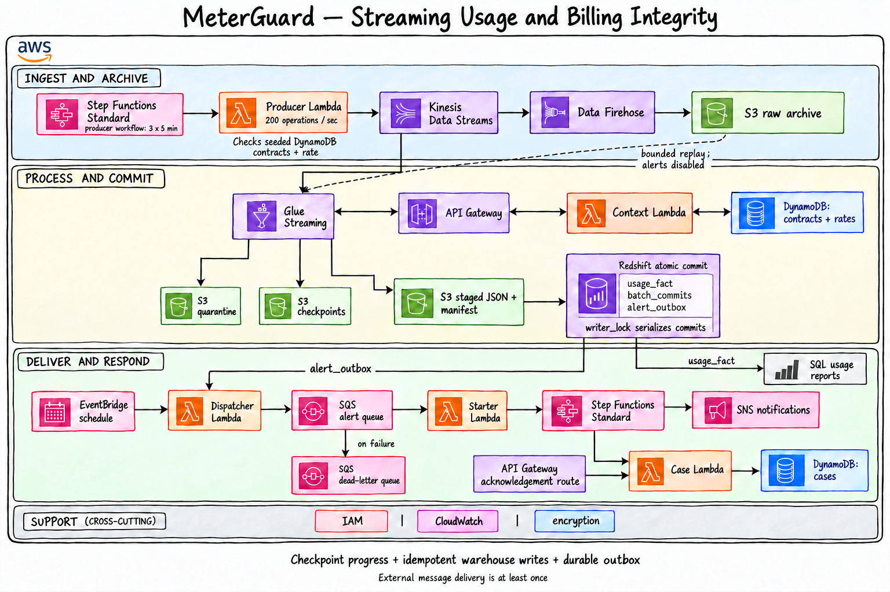
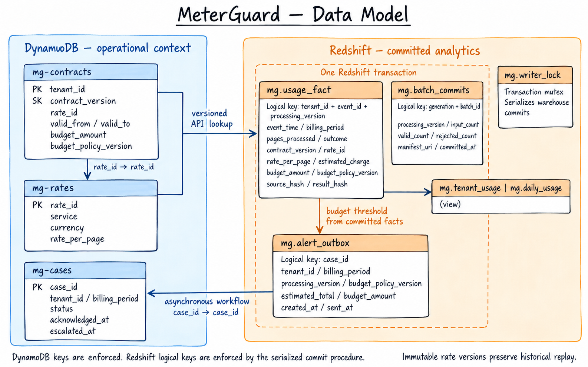

# MeterGuard

MeterGuard converts a stream of document-processing API usage into customer usage totals, charge estimates, and budget alerts on AWS. Start with the [console setup and operating runbook](runbook.md).

## Problem and domain

A document-processing service charges customers for successfully processed pages. Each customer has a versioned contract and rate. Usage can arrive late, arrive more than once, or be reprocessed after a failure. Counting every delivery as new usage would overstate a customer's charges; applying today's price to historical usage would produce a different error.

MeterGuard preserves the identity of each completed operation, resolves its historical pricing through an API, and commits one analytical result per operation and processing version. For example, 20 pages at a configured rate of INR 0.40 produce an INR 8.00 estimate, even if that event is delivered three times.

The implemented pricing model is flat per page, in one currency and under one budget policy per customer billing month. Failed operations have zero estimated charge. New rate versions can take effect within a month. Taxes, credits, invoice finalization, and payment collection are separate business processes.

## Where the data comes from

The included source is a **synthetic usage generator** running as the `mg-producer` Lambda. It represents completed document-processing requests; it does not process PDFs, call a document-extraction service, or read an external dataset. Separately, the contract and price records in `config/reference-items.json` are entered into DynamoDB during setup.

Start `mg-producer-workflow` in the Step Functions console with `producer_sustained` from `config/invocations.json`. Its default workload publishes **180,000 distinct operations over at least 15 minutes**, targeting 200 operations per second, plus 1,800 deliberate duplicate deliveries. Three sequential five-minute Lambda segments leave time for retries within each function's timeout. Workflow transitions and slow requests can extend elapsed time.

Four fictional customers generate loan applications (8–45 pages), insurance claims (3–24), shipment documents (1–8), and invoices (1–5). Approximately 2% of requests fail and have zero processed pages. Every customer has a seeded historical contract; the producer checks these references before publication. Readable IDs such as `REQ-APPLICATION-usage-20261018-001-000000000`, page counts, outcomes, and timestamps are reproducible from the same input and pinned generator version.

The smaller `producer_initial` Lambda input remains a quick correctness check: 100 operations, 2,000 billable pages, and INR 800 after deduplication. Repeating unchanged input preserves operation identity; a fresh `run_id` creates new operations. See the [console execution steps and exact workload totals](runbook.md#publish-the-sustained-workload).

## Architecture

The two API Gateway boxes show lookup and acknowledgement routes on the same API.

1. A Standard Step Functions producer workflow invokes a published Lambda version in bounded segments. Lambda validates its reference data and sends stable usage events to Kinesis. Data Firehose independently archives their JSON envelopes in S3.
2. Glue Streaming reads micro-batches and calls an IAM-protected API Gateway endpoint. A Lambda retrieves the exact contract and rate versions from DynamoDB.
3. Glue stores completed enriched files and a manifest in S3; invalid business records go to quarantine. A Redshift procedure loads the files and commits usage facts, the batch ledger, and pending budget alerts together.
4. A scheduled Lambda dispatches pending alerts to SQS. A second Lambda starts a Standard Step Functions workflow that maintains a DynamoDB case, sends SNS notifications, and checks for acknowledgement.
5. Redshift views expose customer and daily totals. The same Glue script can replay a bounded S3 archive selection, with notifications disabled.

The stream uses 30-second micro-batches. Warehouse startup, API latency, batch processing, and the one-minute dispatcher schedule add latency. Budget alerts are asynchronous and do not enforce a hard spending limit. Redshift unavailability delays both commits and new alerts; recovery resumes pending work.

## Data model

`mg-contracts` uses `(tenant_id, contract_version)` and points to an immutable `mg-rates` item. Each fact retains the resolved rate, budget policy, and hashes of its source and result. `mg-cases` stores acknowledgement and escalation state.

The Redshift fact key is `(tenant_id, event_id, processing_version)`. The batch ledger key is `(generation, batch_id)`. These are logical keys enforced by the serialized commit procedure; Redshift does not enforce primary-key uniqueness. Reports must select a processing version rather than summing multiple versions of the same usage.

## Recovery and correctness

- **Checkpoint recovery:** a live generation owns one Spark checkpoint. A restart keeps that generation and checkpoint. A new query or deliberate replay receives a new generation.
- **Idempotent commits:** the warehouse procedure locks before checking the ledger, rejects conflicting payloads/prices, removes exact duplicates, and inserts only new event keys. Facts, alert intent, and commit metadata share one transaction.
- **Commit-before-checkpoint failure:** a retry reads the completed S3 batch and recognizes the existing warehouse commit. It does not apply the usage again.
- **Reproducible pricing:** contracts and rates are immutable. Completed enriched batches are reused on retry; historical replay resolves the version carried by each event.
- **Replay:** a new replay generation reads a bounded archive prefix and event-time range. Business-key deduplication survives different batch boundaries. Replay never inserts alert-outbox rows.
- **At-least-once delivery:** outbox publishing, SQS delivery, and SNS notifications can repeat. Stable case IDs and conditional case writes protect logical case identity; emails are not guaranteed exactly once.
- **Retention boundary:** recovery requires the relevant Kinesis records or completed S3 archive, retained reference versions, and intact warehouse facts/ledger. Archive failure beyond stream retention can lose data; monitor both consumers.

This establishes exactly-once effects in committed facts under those conditions. It does not assert a global transaction across AWS services. Keep application writes behind the procedure and complete the [cloud acceptance checks](runbook.md#15-verify-the-complete-path) before relying on the deployment.

## File guide

| File | Purpose |
|---|---|
| `README.md` | Project purpose, architecture, model, and correctness contract. |
| `runbook.md` | Sequential AWS console setup, configuration, execution, recovery, monitoring, and cleanup. |
| `lambda/producer.py` | Validates source references, produces paced multi-customer usage or small count inputs, preserves IDs, and retries partial Kinesis failures. |
| `lambda/context_api.py` | Resolves immutable contract/rate snapshots and retries unfinished DynamoDB reads. |
| `lambda/outbox_dispatcher.py` | Reads committed pending alerts, sends them to SQS, and marks successful sends. |
| `lambda/workflow_starter.py` | Starts named Standard workflows and handles repeated queue deliveries. |
| `lambda/case_actions.py` | Creates/reads cases, preserves acknowledgements, and records escalation. |
| `glue/usage_stream.py` | Validates, enriches, stages, commits, checkpoints, and replays usage. |
| `sql/schema.sql` | Creates warehouse tables/views and IAM-mapped database users. |
| `sql/commit_batch.sql` | Defines the atomic, serialized, idempotent warehouse commit procedure. |
| `sql/reports.sql` | Queries totals, duplicate invariants, batch reconciliation, and pending alerts. |
| `config/iam-policies.json` | Named trust and permission policies for console-created execution roles. |
| `config/glue-parameters.json` | Complete Glue argument template, including pinned AWS SDK dependencies. |
| `config/reference-items.json` | Immutable DynamoDB contract/rate items in DynamoDB JSON format. |
| `config/invocations.json` | Console invocation inputs, with explanations of each producer input field. |
| `config/budget-workflow.asl.json` | Commented Step Functions definition for budget-case processing. |
| `config/producer-workflow.asl.json` | Runs paced publication in sequential segments, preserving run identity and offsets across retries. |
| `tests/check_local.py` | Offline checks of generated records, pricing, retries, workflow identity, and configuration contracts. |
| `assets/architecture-v3.png` | Current hand-sketched architecture, including the sustained producer workflow, generated with the built-in ImageGen tool. |
| `assets/data-model.png` | Hand-sketched logical data model generated with the built-in ImageGen tool. |
| `.gitignore` | Excludes Python caches, local environments, and credential scratch files. |
